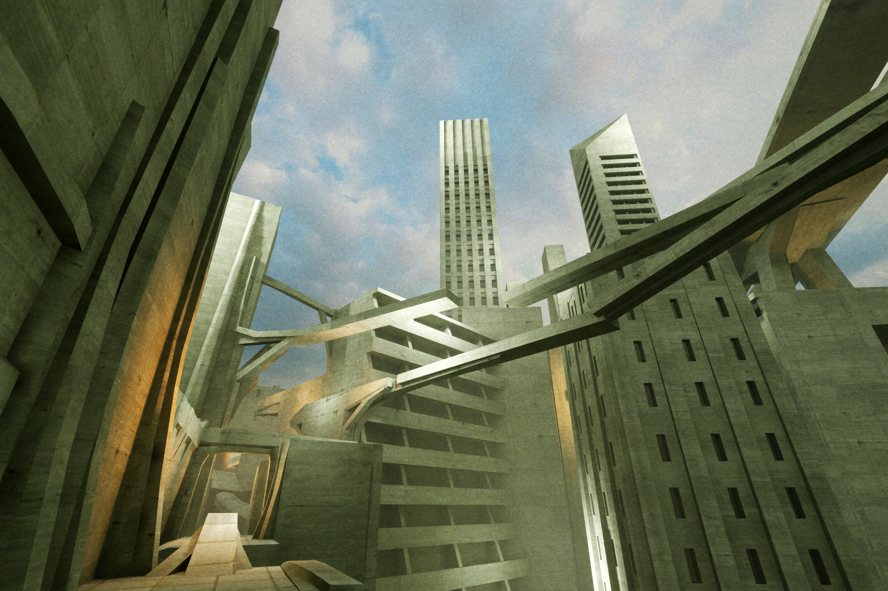
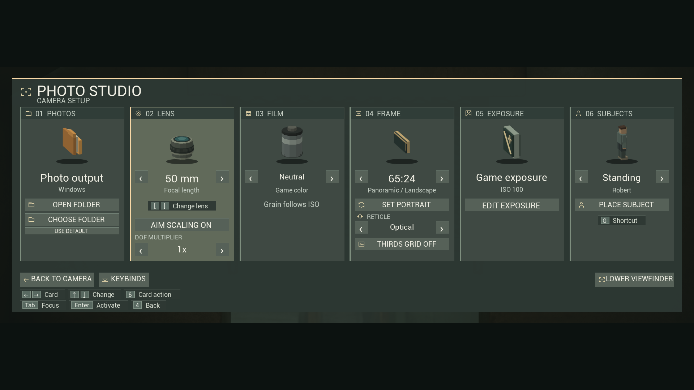
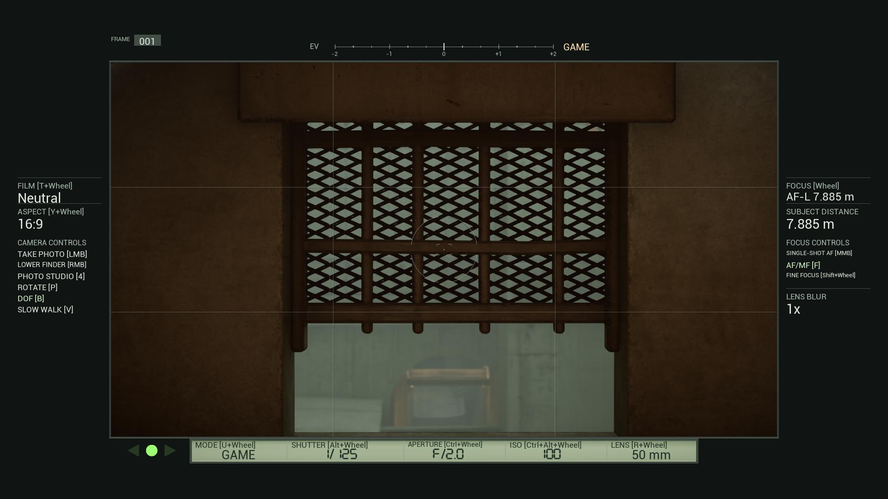
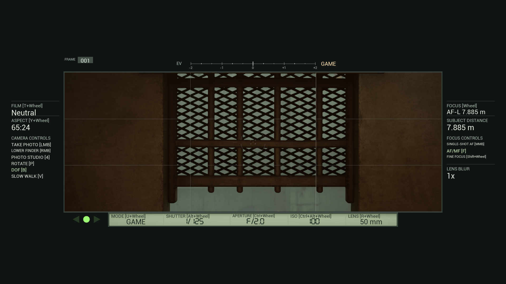
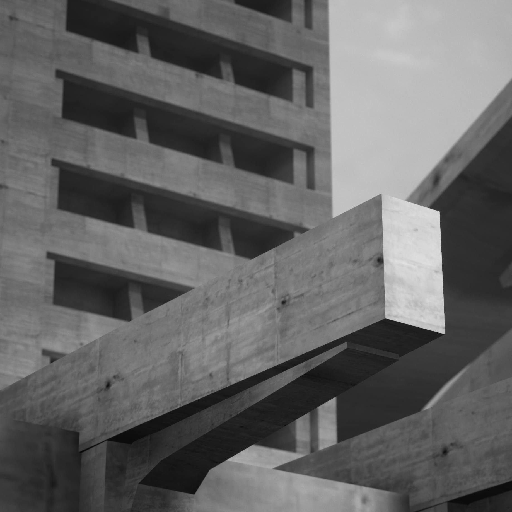
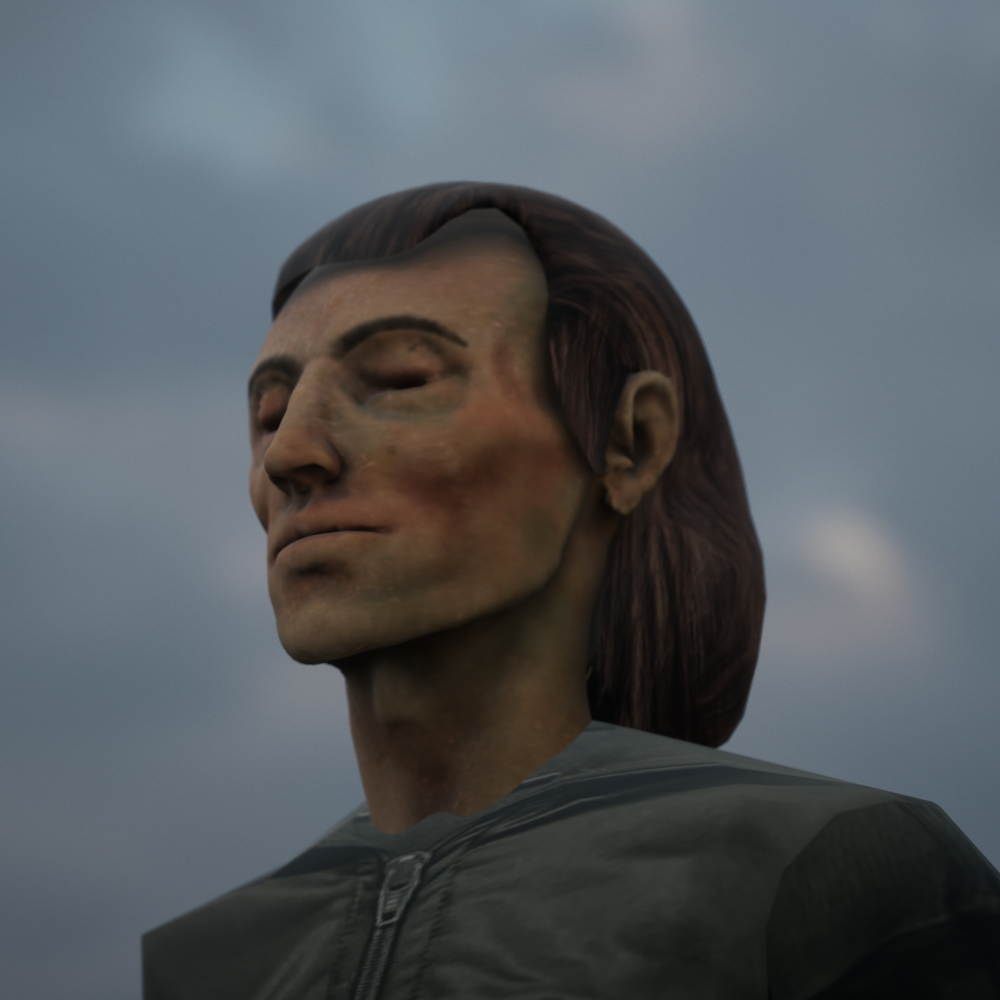

# VHOLUME Photo Camera

A Windows photo mode for VHOLUME with a 35 mm viewfinder, eight lenses, film looks, manual focus, and exposure controls.

**Version 1.1.0** adds Game, Manual, Aperture Priority, and Shutter Priority exposure modes; Auto ISO; slow-shutter motion captures; controller controls; and a redesigned viewfinder. [Full controls guide](GUIDE.md)

[Download the Windows installer ZIP](https://github.com/technicallyalex/vholume-photo-camera/releases/latest/download/VHOLUME-Photo-Camera-Installer.zip) · [Manual install ZIP](https://github.com/technicallyalex/vholume-photo-camera/releases/latest/download/VHOLUME-Photo-Camera.zip)

## Install

1. Close VHOLUME and extract the installer ZIP.
2. Double-click **Install Photo Camera.cmd**. It finds the Steam installation and uses the bundled UE4SS build if needed. If prompted, paste the folder from Steam's **Browse local files** action.
3. Start the game, enter a level, and press **5** to open Photo Studio. **Right-click** raises or lowers the finder. **Left-click** takes a photo with the finder raised.

For a manual install, install UE4SS in `VHOLUME\Binaries\Win64` inside the game's Steam installation folder. Copy `VHOLUMEPhotoCamera` from the manual ZIP's `ue4ss\Mods` into the game's `VHOLUME\Binaries\Win64\ue4ss\Mods` folder. [UE4SS installation guide](https://docs.ue4ss.com/dev/installation-guide.html)

Photos save to `%LOCALAPPDATA%\VHOLUME\Saved\Screenshots\Windows` by default. Choose another destination in **Studio → Photos → Choose Folder**. Tested with VHOLUME Steam build **26455274** and UE4SS **3.0.1-1011-gb50986bd**. Physical controller hardware and Steam Input mappings remain unverified.

## Camera controls

Scroll to focus manually; hold **Shift** for fine focus. Hold **Ctrl**, **Alt**, or **Ctrl + Alt** while scrolling to change aperture, shutter speed, or ISO. **R + wheel** changes lenses, **T + wheel** changes film looks, **Y + wheel** changes aspect ratio, and **U + wheel** changes exposure mode. Rebind the letter modifiers in **Studio → Keybinds → Wheel**. Ctrl still lets you slide.

Select **Lens → DOF Multiplier** for 1x, 2x, 4x, or 8x out-of-focus blur without changing exposure. The Frame card offers a thirds grid and seven ratios, including **21:9** and **65:24**, with portrait rotation.

## Photo Studio

## Viewfinder in action

## Example photos

 
