# VHOLUME Photo Camera

A photography mod for VHOLUME with an optical viewfinder, dedicated controller controls, and modifier-plus-scrollwheel adjustments for the camera's core settings.

**v1.1** brings full-resolution PNG, HDR EXR and DNG photography, an eight-photo background RAW queue, exposure modes and Auto ISO, and matching features on Windows and Linux/Proton. [Download v1.1.0](https://github.com/technicallyalex/vholume-photo-camera/releases/tag/v1.1.0).

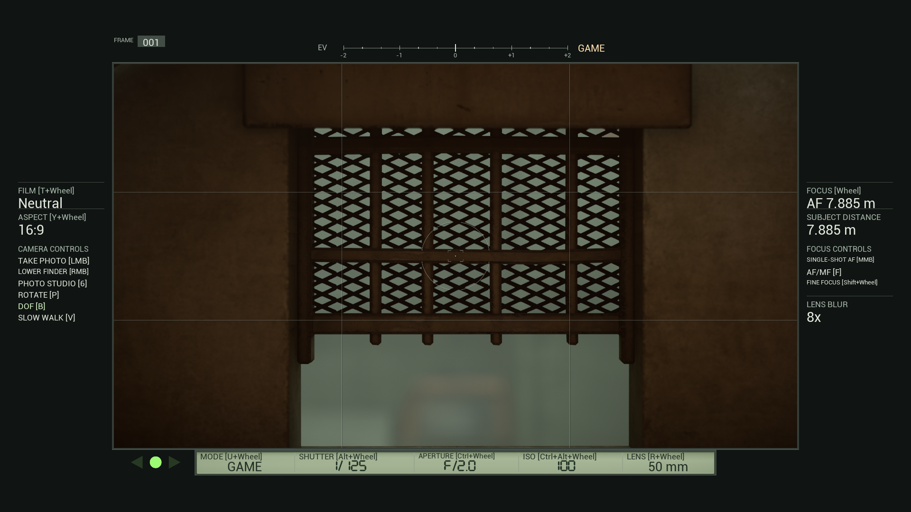

## Controls built for photography

Use the left stick to move and the right stick to aim. **LT** raises the finder, **RT** takes a photo, and **A** focuses. Shoulder buttons and the D-pad adjust focus and exposure; the Studio supports controller navigation. The viewfinder switches its shortcut labels to match the active input device. [Complete controller layout](GUIDE.md#controller)

On keyboard, **5** toggles camera mode and **6** opens Photo Studio. **Right-click** opens the finder from either, **left-click** shoots, and **middle-click** runs single-shot AF.

| Scrollwheel input | Adjusts |
| --- | --- |
| Wheel / Shift + wheel | Focus / fine focus |
| Ctrl + wheel / Alt + wheel | Aperture / shutter speed |
| Ctrl + Alt + wheel | ISO |
| R / T / Y / U + wheel | Lens / film / aspect ratio / exposure mode |

Letter modifiers are editable in **Studio > Keybinds > Wheel**. Camera input takes priority while the finder is raised; movement and mouse-look remain available, including Ctrl to slide. The game's pause menu remains accessible.

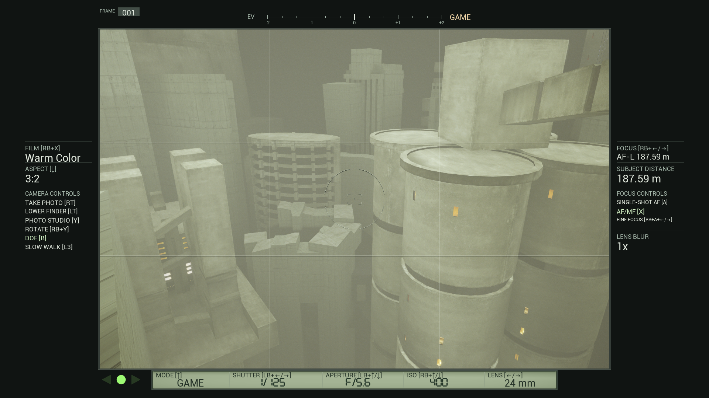

## Full-resolution photos and RAW editing

Render the complete photo directly at its selected size and aspect ratio, independently of the smaller viewfinder frame. Choose game resolution or a long edge of **1280, 1920, 2560, 3840, 5760 or 7680 pixels**. Dedicated render keeps gameplay resolution unchanged. An optional temporary-resolution method restores the game's original resolution and display mode after capture, cancellation or failure.

| Format | What it saves |
| --- | --- |
| PNG | The finished film look and ISO-based grain |
| EXR | Scene-linear HDR RGB before the film look and artificial grain |
| DNG | Lossless linear HDR RGB with ISO, aperture, shutter, focal length and capture-time metadata |

Save any combination of all three. DNG works with familiar RAW editing tools such as Photoshop / Camera Raw. It contains rendered RGB: focus blur, depth of field, exposure and motion are baked into the pixels. Its available highlight range comes from the scene render. [Capture and editing guide](GUIDE.md#full-resolution-photos-and-hdr-output)

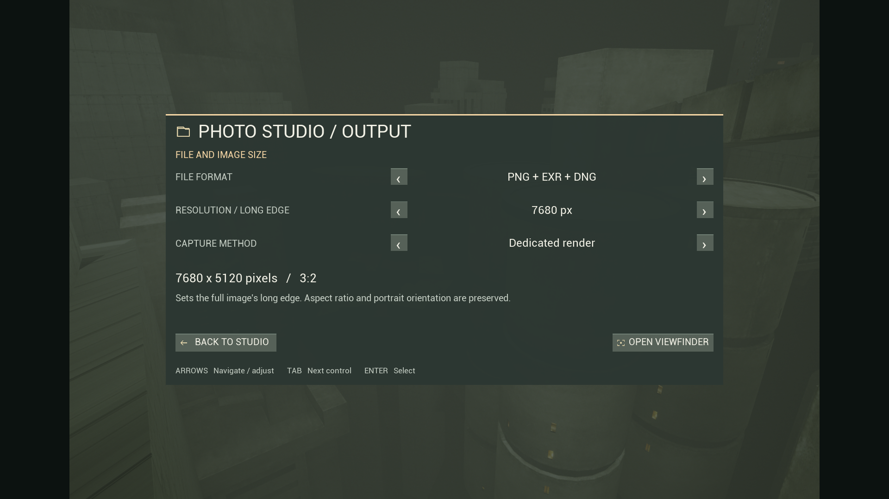

An **eight-photo background DNG queue** lets you keep shooting once each frame has rendered and exported. Each photo keeps its own settings. Lowering the finder, opening Studio, stowing or pausing leaves captured photos saving. Interrupted queues recover next launch, and a failed conversion does not stop the remaining photos. Rendering and source export still take time.

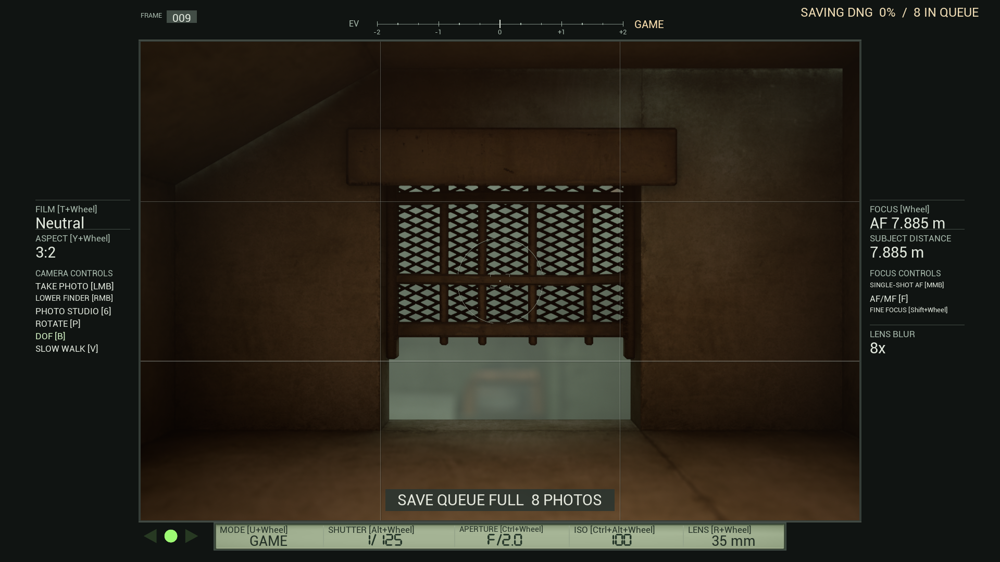

## Exposure, optics and film

Choose **Game**, **Manual**, **Aperture Priority**, or **Shutter Priority**. Auto ISO has adjustable minimum and maximum values and a preferred minimum shutter in Aperture Priority. ISO controls grain across all eleven generic film looks, rather than grain being fixed to a film preset.

- Eight lenses: **16, 24, 35, 50, 85, 135, 200 and 600 mm**, each with its own model.
- **f/1.0 to f/16**, shutter speeds from **8 seconds to 1/32000 second**, and **ISO 100 to 6400**.
- Manual and fine focus, single-shot AF, DOF on by default, and a **1x / 2x / 4x / 8x lens blur multiplier** that leaves exposure unchanged.
- Optional aim-sensitivity scaling for zoomed lenses; wide lenses do not speed up the base sensitivity.
- Intentional camera motion during exposures of **1/15 second or slower** in the physical exposure modes.

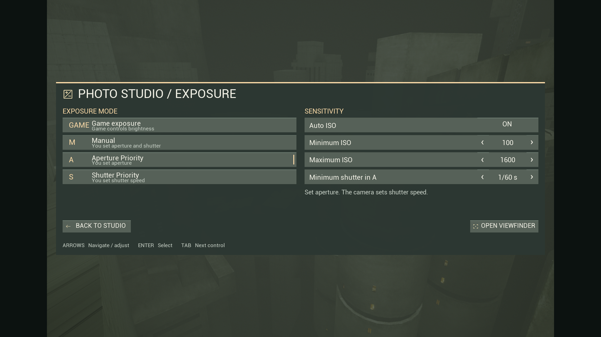

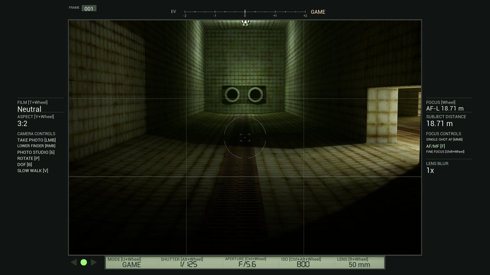

## Optical viewfinder and Photo Studio

The shaded LCD places keybinds beside mode, shutter, aperture, ISO and lens. The EV meter sits above the image, focus lamps beside the LCD, and fixed sidebars show film, framing and focus information. Choose **Optical, Square, Circle or None** for the reticle and optionally enable a rule-of-thirds grid.

Seven aspect ratios include **3:2, 4:3, 1:1, 16:9, 5:4, 21:9 and 65:24**, with portrait rotation. Sidebars stay beside the image even in wide formats.

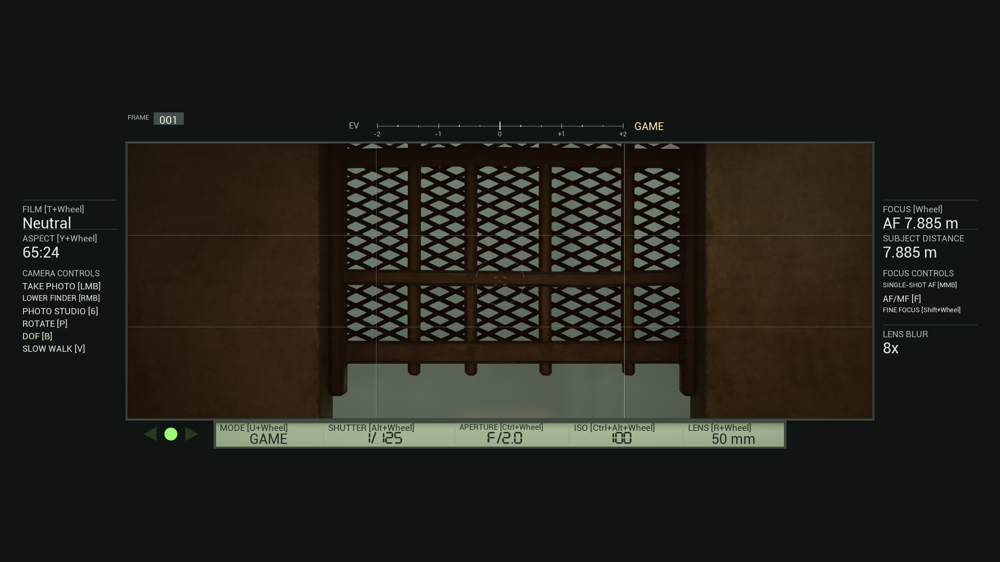

Studio groups Photos, Lens, Film, Frame, Exposure and Subjects into consistent panels with rotating low-poly icons. Choose or open the output folder, configure capture settings, change keybinds, and place subjects with five poses. **G** starts subject placement; Studio also has a Place Subject button. Camera handling uses synthesized mechanical sounds.

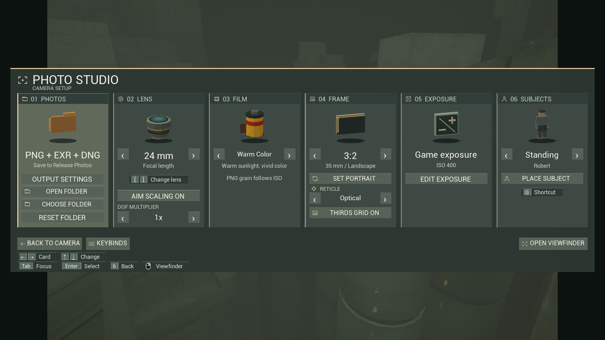

## Downloads and installation

The **v1.1.0 Windows and Linux packages are available together**. Linux includes the same camera and capture features, with a bundled native DNG converter; users do not need a .NET installation.

| Platform | Current build | Downloads | Status |
| --- | --- | --- | --- |
| Windows | **v1.1.0** | [Installer](https://github.com/technicallyalex/vholume-photo-camera/releases/download/v1.1.0/VHOLUME-Photo-Camera-v1.1.0-Windows-Installer.zip) / [Manual ZIP](https://github.com/technicallyalex/vholume-photo-camera/releases/download/v1.1.0/VHOLUME-Photo-Camera-v1.1.0-Windows-Manual.zip) | In-game Windows QA |
| Linux / Proton | **v1.1.0** | [Linux installer package](https://github.com/technicallyalex/vholume-photo-camera/releases/download/v1.1.0/VHOLUME-Photo-Camera-v1.1.0-Linux-Proton.zip) | Experimental; automated Linux QA |

[Release notes and checksums](https://github.com/technicallyalex/vholume-photo-camera/releases/tag/v1.1.0) / [Earlier releases](https://github.com/technicallyalex/vholume-photo-camera/releases). Choose the package for your operating system; previous versions remain available.

**Windows:** close the game, extract the installer, and run **Install Photo Camera.cmd**. It finds the Steam installation, installs the bundled UE4SS loader if needed, and backs up a previous mod. Manual installation and rollback are covered in the [guide](GUIDE.md#install-and-switch-back).

**Linux / Proton:** extract the Linux package, run `python3 install-linux.py`, and copy its complete printed launch option into Steam's VHOLUME properties. Python 3.9+ is required. [Linux setup](LINUX.md) covers prefixes, optional native folder choosers, and Flatpak limits.

Photos default to `%LOCALAPPDATA%\VHOLUME\Saved\Screenshots\Windows` on Windows, or the corresponding directory inside the Proton prefix. Change it in **Studio > Photos > Choose Folder**.

## Compatibility

Windows was tested in the actual game, including all seven output combinations, motion, temporary-resolution recovery, and dedicated 6K/8K captures. The Linux installer, native RAW converter and shared camera logic passed automated Ubuntu 22.04 and 24.04 checks. Linux uses the same camera scripts and assets except for folder and process adapters.

**Linux remains experimental:** live Proton gameplay, GPU capture, Steam Deck, Linux desktop GUI integration and sound playback are unverified. Controller logic was tested with simulated inputs; physical controllers and Steam Input mappings remain unverified on both platforms. Camera Raw opened the DNGs; Lightroom itself was not tested. Tested game build: **26455274**; UE4SS: **3.0.1-1011-gb50986bd**.

## Example photos

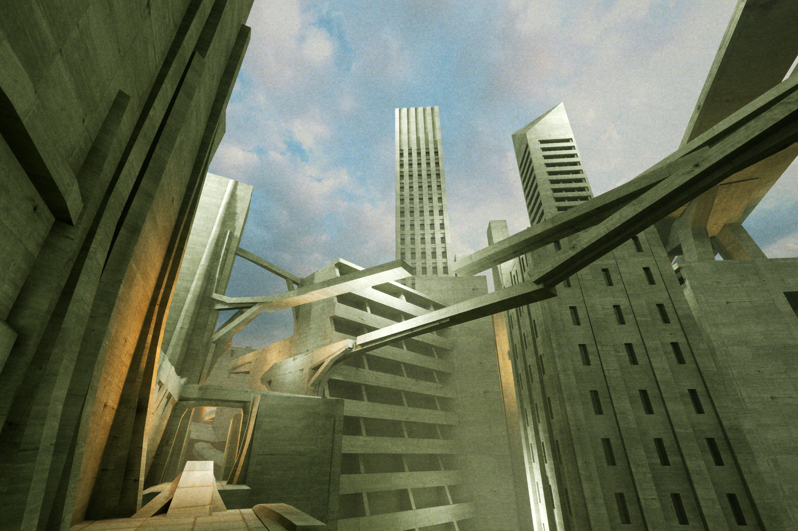

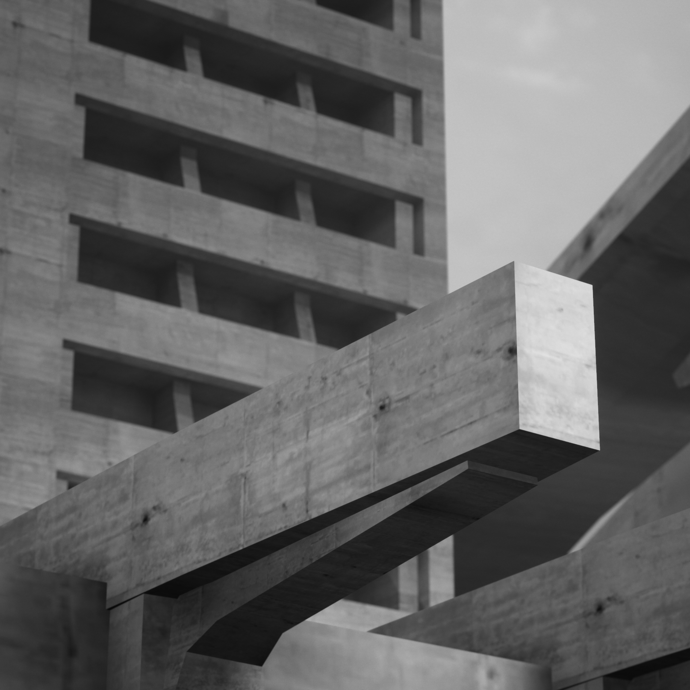 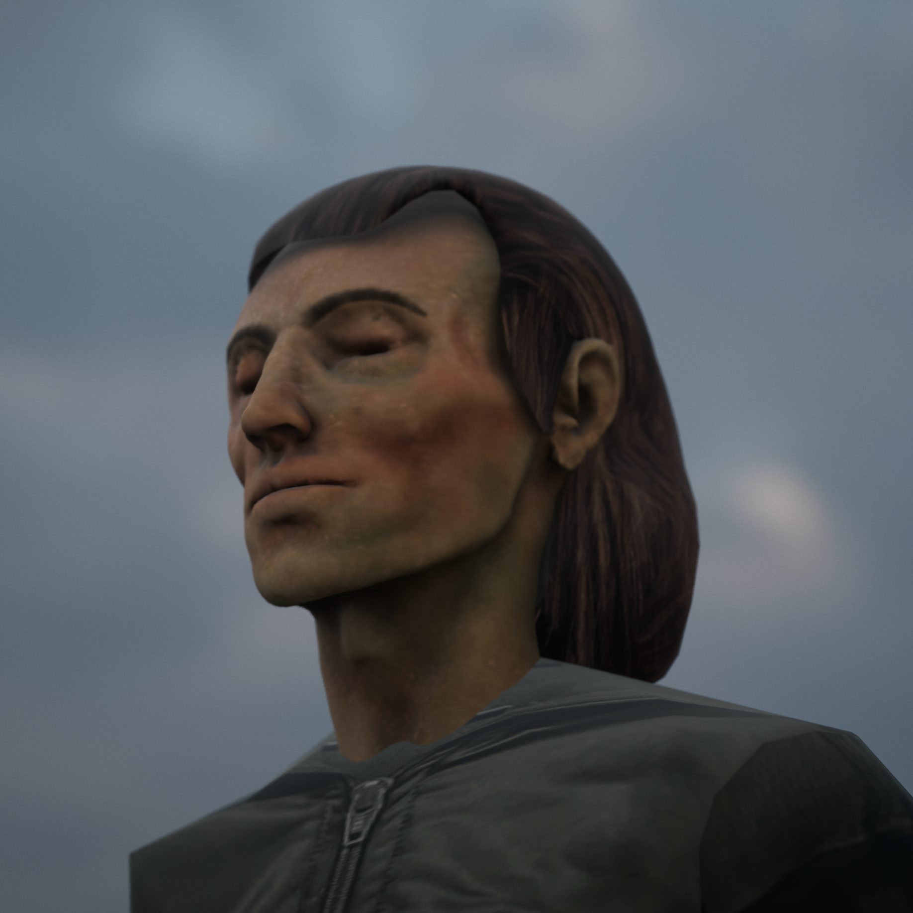

## Credits

Camera RAW support was inspired by [NewBarkTownKris](https://github.com/NewBarkTownKris) and their [Denshattack! Photo Camera](https://github.com/NewBarkTownKris/denshattack-photo-camera).

This product includes DNG technology under license by Adobe.
