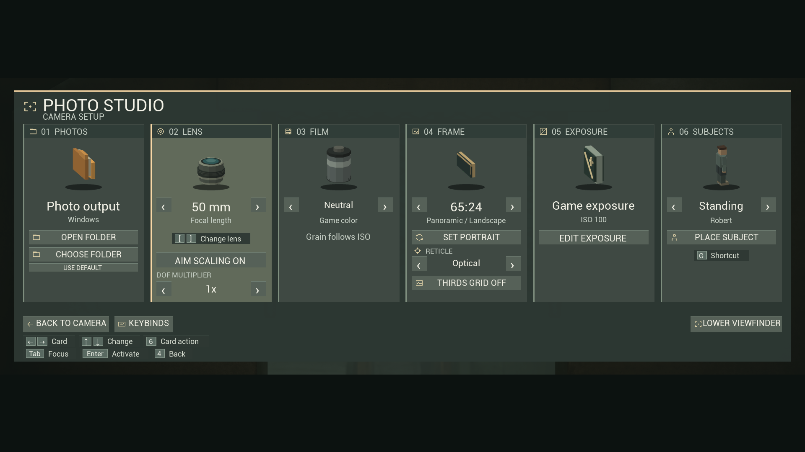
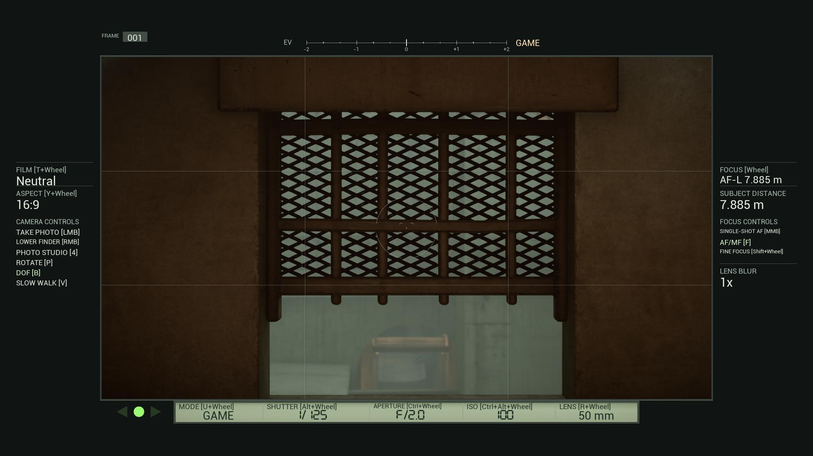

# VHOLUME Photo Camera v1.1.0 — Camera Controls Overhaul

A complete camera controls overhaul, with a dedicated controller layout and modifier + scrollwheel controls for the camera's core functions. Adjust settings directly from the viewfinder, with the relevant shortcuts shown beside each setting.

- Dedicated controller controls for shooting, autofocus, manual focus, exposure, lens selection, and Studio navigation.
- A scrollwheel control system for focus, aperture, shutter speed, ISO, lenses, film looks, aspect ratio, and exposure mode, with editable letter-key modifiers and fine-focus adjustment.
- Camera input priority preserves movement, mouse look, and Ctrl sliding while camera controls are active.
- Game, Manual, Aperture Priority, and Shutter Priority modes, plus Auto ISO with adjustable limits.
- ISO-driven film grain and slow-shutter captures that blend camera movement into the photo.
- A shaded LCD, clearer panel text, and fixed left/right sidebars, including at 16:9.
- Lens DOF multipliers from 1x to 8x, a thirds grid, and new 21:9 and 65:24 formats.
- A selectable screenshot folder in Photo Studio.

Download **VHOLUME-Photo-Camera-Installer.zip**, close the game, extract it, and run **Install Photo Camera.cmd**. The installer detects Steam and backs up an existing Photo Camera installation. The manual ZIP is also available. Updating replaces the current mod in its existing slot; use the dated backup or an earlier release to switch back.

Tested with VHOLUME Steam build **26455274** and UE4SS **3.0.1-1011-gb50986bd**. Physical controller hardware and Steam Input mappings remain unverified. Motion capture sample density depends on game frame rate.

[Controls and settings](https://github.com/technicallyalex/vholume-photo-camera/blob/v1.1.0/GUIDE.md)

