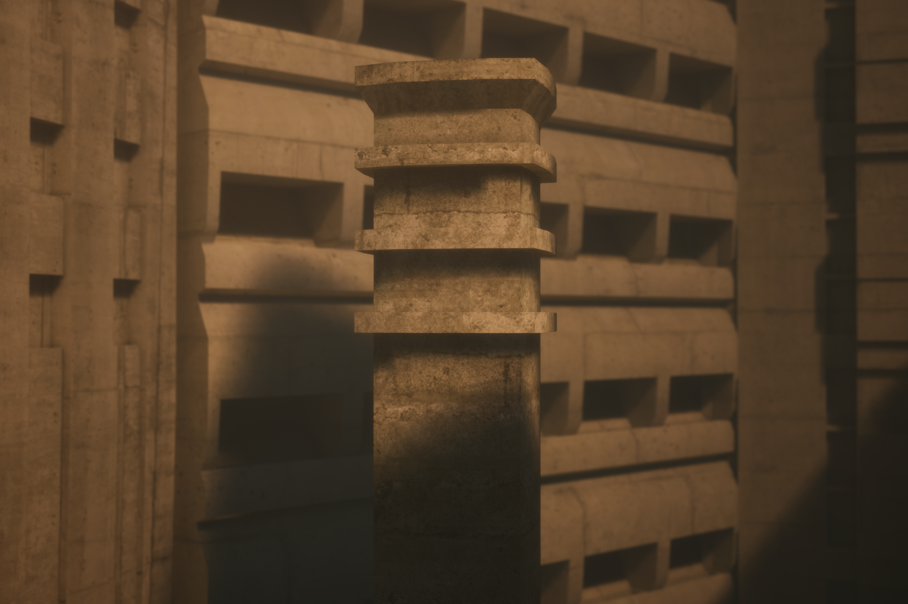
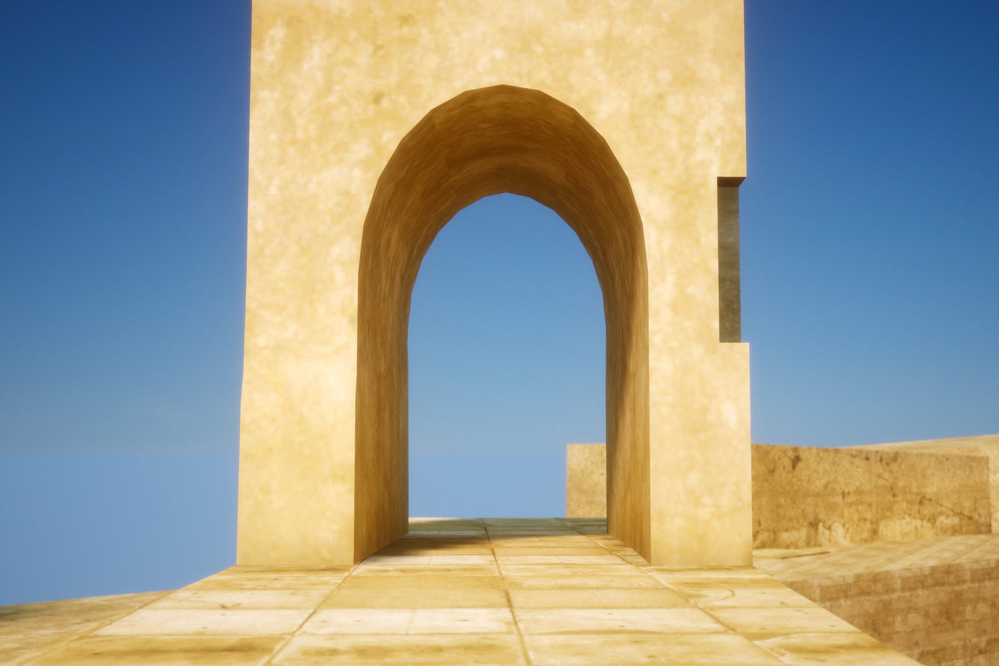
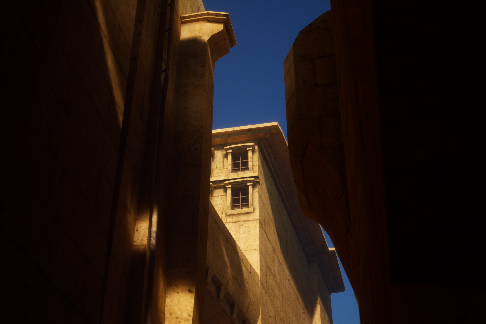
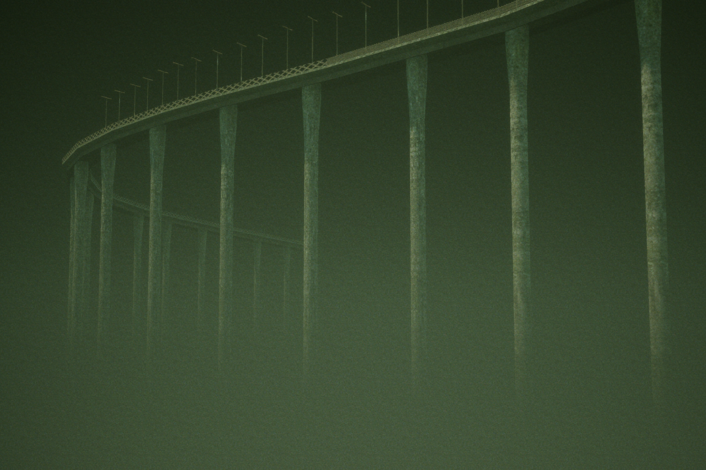
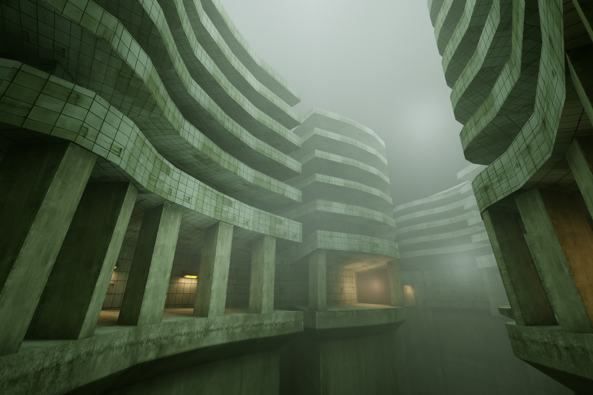
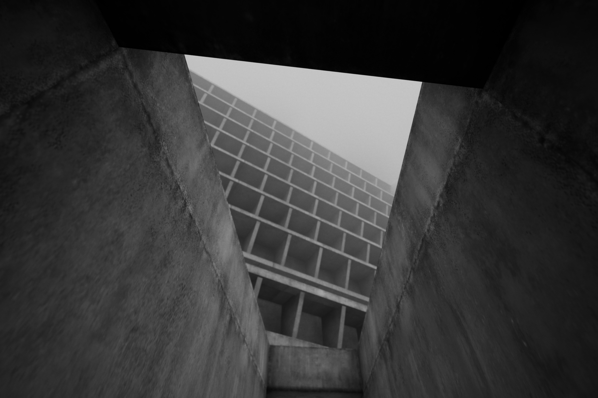
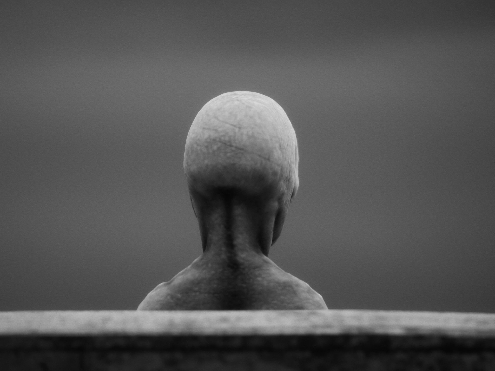

# Screenshot gallery

The current UI screenshots were captured in the actual v1.1.0 Windows build on 23 November 2026, without image retouching or resampling. The scenes span three different game maps:

- **Conapt:** a city overlook, controller shortcuts, Photo Studio, output settings, exposure/Auto ISO, and two real queued RAW captures.
- **Nightlife:** lit buildings in 65:24 panoramic framing with the Tungsten film look.
- **Showers:** a tiled interior photographed with the 50 mm lens.

`screenshots.json` records each map, resolution and image hash. Screenshot QA positions scene cameras in the engine; the visible image, effects, controls and UI are rendered by the game and mod. Controller buttons were simulated to exercise the actual input path; no physical controller test is implied.

`city-16mm.png`, `concrete-85mm.png` and `portrait-135mm.png` are the user's earlier example photographs, retained as examples of the mod's output.

## Additional example photos

Eleven additional photographs supplied by the mod's author. The original PNG files are included without edits or resizing. Open any image for the full-resolution file.

 

Stacked concrete detail, 50 mm, Neutral, ISO 100 / Sunlit arch, 50 mm, Vivid Color, ISO 320

 

Golden city architecture, 16 mm, Vivid Color, ISO 320 / Tower detail with soft foreground, 85 mm, Vivid Color, ISO 320

 

Sunlit alley, 50 mm, Vivid Color, ISO 320 / Bridge in the mist, 50 mm, ISO 2500

 

Blurred night tower, 16 mm, Crisp B&W, ISO 100 / Red-lit arch in the mist, 16 mm, Vivid Slide, ISO 125

 

Misty courtyard, 16 mm, ISO 400 / Monochrome architectural framing, 16 mm, Crisp B&W, ISO 400

Monochrome portrait, 200 mm
